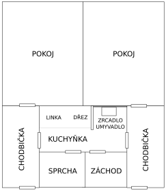

# Jak to tu vypadá?

Naše kolej se nachází na břehu Vltavy, na pomezí malebné městské části zvané Troja a trochu rozlehlejší městské části Libeň. Co by kamenem dohodil od oblasti Holešovice. Poblíž se nachází široká silnice nazývaná magistrála (silnice je dlouhá, mezi její názvy patří Argentinská, Most Barikádníků a V Holešovičkách), na které se, obzvláště v ranních hodinách a okolo 17.–18. hodiny, tvoří úporné zácpy. Kolmo na magistrálu pak vede městský okruh do tunelu Blanka kopírující břeh Vltavy, který je zas ideální na procházky a kolečkové brusle (viz [Cyklostezka](#cyklostezka)).

## Pokoje

Na 17. listopadu jsou skoro všechny pokoje stejné – dvoulůžkové se sociálním zařízením. Vypadá to tak, že jsou vždy dva pokoje spojeny průchodem, ve kterém se nachází kuchyňka, záchod a sprchový kout. Dohromady se tomuto celku říká buňka.

{width=55%}

Na 5., 6. a 7. patře budovy A a 4. a 5. patře budovy B se nachází jednolůžkové pokoje, které jsou stavebně stejné jako ostatní, liší se však vybavením – mají pouze jednu postel i stůl a většinou novější sociální zařízení. Pokud máte zájem bydlet na jednolůžkovém pokoji, zajděte do ubytovací kanceláře poprosit o zápis na čekací listinu. Jelikož je jednolůžkových pokojů pouze 104 a zájem je velký, což je pochopitelné vzhledem k ceně vyšší o necelých 1200 Kč měsíčně při celoročním ubytování, tak se na ně čeká dlouho (odhadem 2–3 roky).

V každém pokoji se nachází jeden nízký čtvercový stolek a po dvou: postele, pracovní stoly s šuplíky, židle „student“, skříňky, poličky na knihy. V chodbičce potom celkem tři velké a šest menších skříní, přičemž ty menší (položené na zemi, či až navrchu u stropu) bývá často zvykem sundávat a stěhovat do pokoje jako další úložný prostor.

Kromě toho existují ještě pokoje s druhou předsíňkou – jsou to ty, které sousedí s výtahovými šachtami. Jejich množství je ale značně omezené (dva na každém patře) a jejich obyvatelé se jich neradi vzdávají.

To, že základní rozestavení pokoje je jedno z nejhorších, které lze vymyslet, je kompenzováno tím, že si můžete nábytek rozestavět, jak se vám zamane, pokud ho před vystěhováním uvedete do původního stavu, nebo se domluvíte s lidmi, kteří se tam mají nastěhovat po vás. Až budete vymýšlet rozestavění nábytku na pokoji, můžete místo šoupání postelemi sem a tam použít [„rozestavovač nábytku“](https://listopad.koleje.cuni.cz/rozestavovacNabytku).

## Kuchyňka

Nachází se v úzké chodbičce mezi dvěma pokoji. Je vybavena kuchyňskou linkou, dřezem, malou ledničkou, sporákem s dvěma plotýnkami a několika skříňkami na nádobí různé velikosti.

Co by vás mohlo při nastěhování zaskočit, je absence jakéhokoliv nádobí – vše (nádobí, příbory, hrnce, hrníčky, misky, …) si musíte přivézt z domu, nebo doufat, že je tam nechali předchozí nájemníci, což se občasně stane. Stav takového vybavení může však být značně pochybný.

Je velmi užitečné mít spotřebiče jako rychlovarnou konvici a mikrovlnku, ale ty stačí jedny na celou buňku, a tak se před tím domluvte s ostatními spolubydlícími, kdo co přiveze, ať nemáte třeba tři rychlovarky. Takové množství je nejenom zbytečné, ale navíc použití tolika spotřebičů zároveň bývá příliš velká zátěž pro naše staré a slabé (hliníkové) elektrické vedení, takže hrozí, že tím zničíte rozvod nebo vyhodíte jistič. Nemluvě o tom, že se nevejdete na kuchyňskou linku! Inspiraci pro další užitečné věci, které si s sebou na kolej přivézt, najdete [ve Facebookovém příspěvku](https://fb.com/groups/koleje/posts/10158823635093015/).

Další věcí, která nově příchozího obvykle překvapí, je opravdu malá lednice. V provozu je několik verzí, ale i do největší z nich se čtyři lidi, kteří lednici sdílejí, mívají občas problém vmáčknout.

Naštěstí si lze lednici vyměnit, po dohodě s vedoucí koleje, za vlastní. Případně, taktéž po dohodě, mít svoji lednici navíc k erární, ale je potřeba počítat s měsíčním poplatkem za elektřinu – zhruba 100 Kč.

Za případné elektrospotřebiče ale nesete zodpovědnost, i za veškeré problémy a poškození majetku koleje s jejich použitím spojené! Je proto vhodné mít spotřebiče, které nejsou v posledním tažení a u nichž jste přesvědčeni o jejich bezpečnosti. Zařízení s velkými bateriemi, jako jsou elektrokola a elektrokoloběžky, jsou z důvodu požárního rizika v prostorách koleje úplně zakázána.

## „Židle student“

Židle student je standardním vybavením všech pokojů. Má koženkový sedák, dřevěné opěradlo, chybí jí opěrky pro ruce a jakákoliv podpora bederní páteře. Vřele doporučujeme si místo ní koupit kvalitní kancelářské křeslo – během následujících let budete mít mnohem větší pohodlí a vaše záda to taky ocení. Pokud se však rozhodnete používat židli student, určitě se zastavte ve skladu prádla, kde zdarma rozdávají filcové podložky (pod nohy židle), díky kterým ušetříte podlahu i svoje uši během posouvání židle všemi možnými směry. A pokud se vám židle student rozbije, tak pro pořízení nové navštivte hospodyni.

[Židle student se vyskytuje i v komiksu MaFian liFe od Daniela Scheiricha](https://www-ucjf.troja.mff.cuni.cz/scheirich/?page%20id=67). Přečtení komiksu lze jenom doporučit, je v něm spousta kulturních referencí i na naši kolej.

## Lampičky

Od počátku věků byly na studentských pokojích lampičky. Během revizí elektroinstalace v roce 2022 nám však byly odebrány. Studenti však statečně a vytrvale protestovali pomocí petice i [velmi kreativní tvorby](https://fb.com/groups/koleje/posts/10158949517648015/), až se jim podařilo vyjednat ústupek – pokud chcete kolejní lampičku, zajděte do kanceláře vedoucí za panem Holubem, u kterého si za zálohu asi 200 Kč můžete jednu půjčit.

## Horko v létě

Přes léto tu bývá velmi horko, proto pro vás Kolejní rada připravila [hot summer guide](https://listopad.koleje.cuni.cz/dokumenty/hot-summer-guide.pdf).
