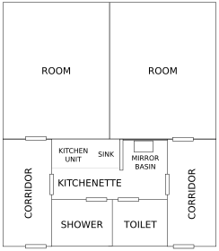

# What does it look like?

Our dormitory is located on the banks of the Vltava river, on the border between the picturesque town district of Troja and the slightly larger town district of Libeň. A stone’s throw away is a wide expressway called the “Magistrála” (the road is long, its names include Argentinská, Most Barikadníků, and V Holešovičkách). The road is prone to heavy traffic jams, especially in the morning and around 5–6 p.m. Perpendicular to the expressway, the city ring road leads to the Blanka tunnel, which follows the bank of the Vltava River, which is ideal for walking and rollerblading (see [Cycling path](#cycling-path)).

## Rooms

At the 17. listopadu Dormitory, almost all rooms are the same – doubles with facilities. There are always two rooms connected by a passage in which there is a kitchenette, toilet, and shower. Together, this unit is called a cell.

{width=55%}

On the 5^th^, 6^th^, and 7^th^ floors of building A and on the 4^th^ and 5^th^ floors of building B, there are single rooms, which are structurally the same as the others, but differ in terms of furniture as they have only one bed and one table available in the room, and often newer kitchens and showers. If you are interested in staying in a single room, please visit the accommodation office to request being added to the waiting list. Since there are only 104 single rooms and the demand is high, which is understandable given the price is just under CZK 1200 more per month for year-round accommodation, the wait time is long (estimated at 2–3 years).

In each room, there is one low square table and two of each of the following: beds, desks with drawers, “student” type chairs, cabinets, and bookshelves.

In the hallway, there are a total of three large wardrobes and six smaller cabinets. The smaller cabinets (placed on the ground or on top near the ceiling) are often taken down and moved into the room for additional storage space.

In addition, there are rooms with a second hallway – these are the ones adjacent to the lift shafts. However, their number is very limited (two on each floor), and their inhabitants do not like to give them up.

The fact that the basic layout of the room is one of the worst imaginable is compensated by the fact that you can rearrange your furniture as you please, as long as you put it back to its original position before moving out or arrange with the people who are to move in after you. When rearranging the furniture in the room, you can use [the virtual furniture mover](https://listopad.koleje.cuni.cz/rozestavovacNabytku) instead of moving the beds back and forth.

## Kitchenette

The kitchenette is located in a narrow corridor between two rooms. It is equipped with a kitchen unit, a sink, a small refrigerator, a stove with two burners, and several cupboards for dishes of different sizes.

What might surprise you when you move in is the absence of any dishes – you have to bring everything from home (dishes, cutlery, pots, cups, bowls, etc.) or hope that your neighbours will share or that the students living there before you left some stuff behind, which sometimes does happen. The state of that equipment can however be pretty questionable.

It is very useful to have small appliances such as a kettle and a microwave, but you only need one for the whole cell, so discuss with the other roommates beforehand who will bring what, so that you don’t have, for example, three kettles. This is not only unnecessary, but using so many appliances at the same time tends to be too much of a burden on our old and weak (aluminium) electrical wiring, so you risk damaging the electrical system or tripping a circuit breaker. Also you have limited space, so be wise about using it. You can find inspiration for other useful things to bring with you to the dormitory in [the Facebook post](https://fb.com/groups/koleje/posts/10158823635093015/).

Another thing that usually surprises newcomers is the really small fridge. There are several versions in use, but even in the largest one, four people sharing the fridge sometimes have trouble fitting everything in.

Fortunately, you can replace the refrigerator with your own after agreeing with the head of the dormitory. Or, also by agreement, you can have your own fridge in addition to the one already there, but you need to take into account the monthly electricity fee – around CZK 100.

You are however responsible for your own equipment and electronic devices and any problems or damages caused by them. It is therefore more than recommended to have electronic equipment in good condition with safety guarantees. Devices with large batteries, such as electric bikes and scooters, are completely prohibited in the dormitory due to fire risk.

## “Student” type chair

“Student” type chairs are standard furniture in all rooms. They have a faux leather seat and a wooden back, but lack armrests or any lumbar support. We highly recommend buying a quality office chair instead – you’ll be much more comfortable over the coming years, and your back will appreciate it, too. However, if you decide to use the “student” type chair, be sure to stop by the laundry storage room, where they will provide you with free felt pads (to put under the chair legs), thanks to which you will save the floor and your ears when sliding the chair in and out. If the chair breaks, pay a visit to “Hospodyně = Housekeeper” for a replacement.

## Lamps

From the edge of time, there were lamps in the rooms. After a revision of electronic devices in 2022, the lamps were removed. However, the students protested persistently and [creatively](https://fb.com/groups/koleje/posts/10158949517648015/) against that decision and the way it was (not) communicated and succeeded at least partly. You are now able to borrow a lamp from Mr. Holub (building B, behind the elevators on the left in the same place as the head of our dormitory, Mrs. Jana Provazníková) for a returnable deposit of CZK 200.

## Hot summer guide

It’s terribly hot here in summer, so the Dormitory council prepared a [hot summer guide](https://listopad.koleje.cuni.cz/dokumenty/hot-summer-guide.pdf) for you.
