# Contributing

1. If you do not have direct access to the repository, you need to create your own copy. This is called "forking".

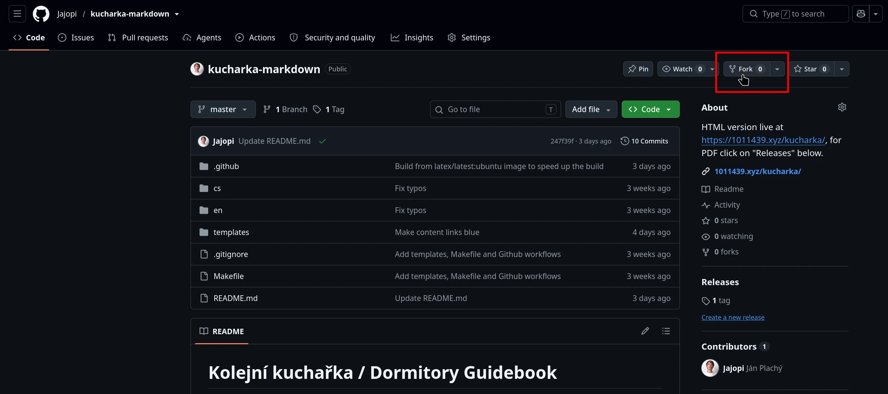

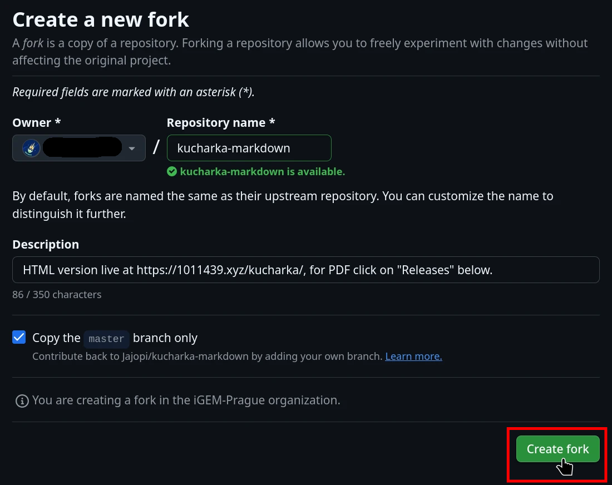

2. You can make any changes to you copy.
Editing from the web is simple and useful for smaller changes (for bigger ones, search for some git tutorial).
First of all, you need to navigate to the file you want to edit.

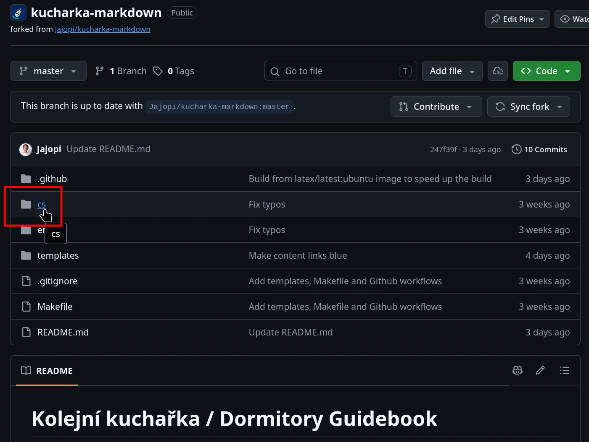

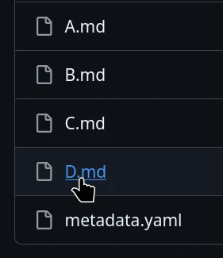

3. Once you viewing the file, click on the pencil icon to edit it.

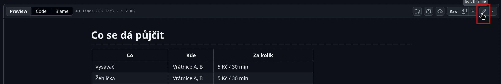

4. When editing, you can switch between the text editor and the preview.
One you are happy with the changes, click the green "Commit changes" button.

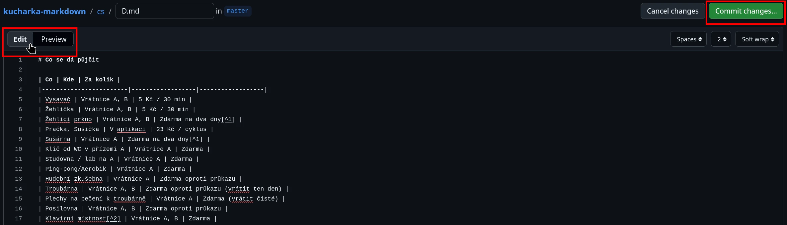

5. Write a short description of the changes your edit makes to the text and click the green "Commit changes" button again.

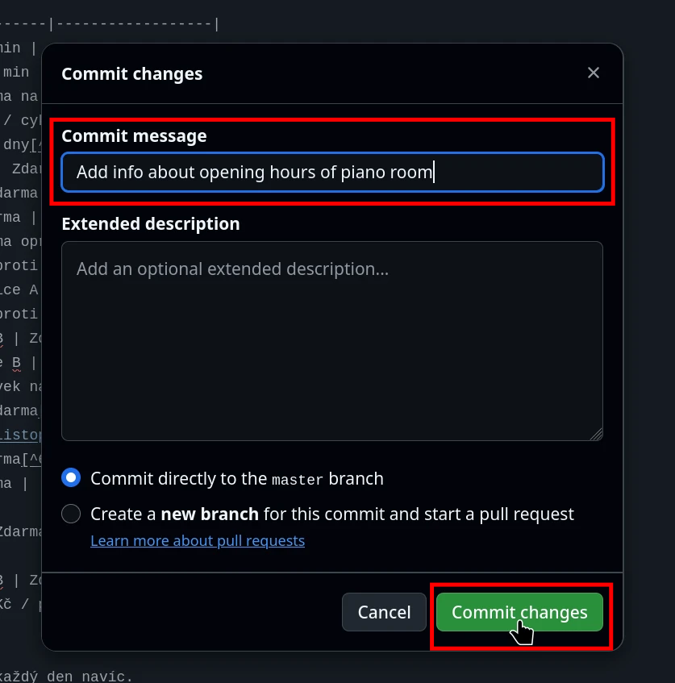

6. You can edit any number of files.
Once you are done, return to the default view by clicking the "Code" tab.

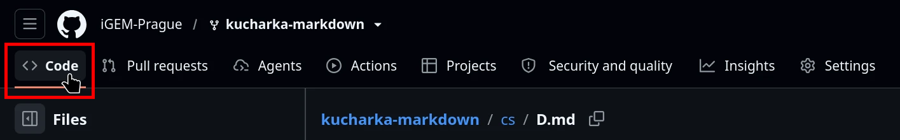

7. There will be two options shown: "Contribute" and "Sync fork".
The first one is for sending your changes to the original repository.

> The second one is for updating your copy with changes from the original repository -- use it if you contibute again after some time, so you always edit the latest version.

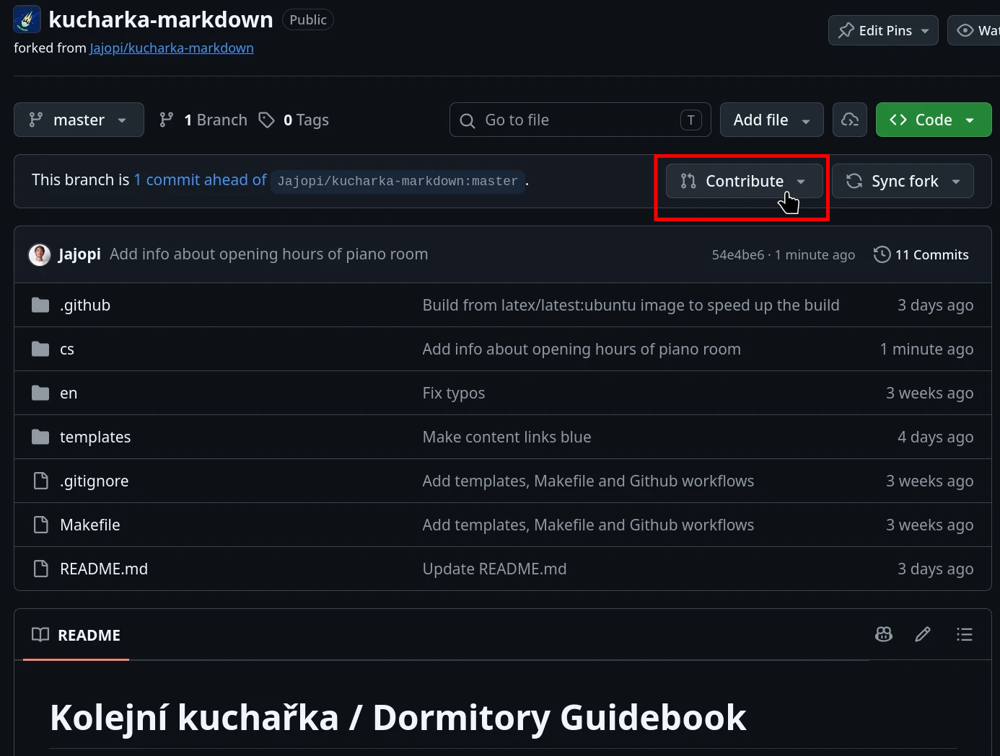

8. Write about the changes you made and the motivation for them, then click the green "Create pull request" button.

> You can also see a summary of the changes you made by clicking the "Files changed" tab or scrolling down.

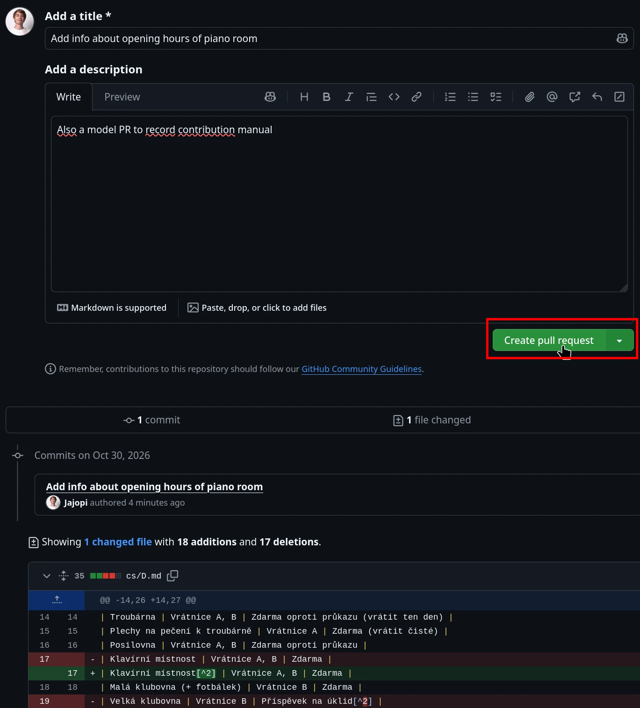

9. If there is a problem with your changes or something is missing, you will get a comment (or a request to change something) from the maintainers.

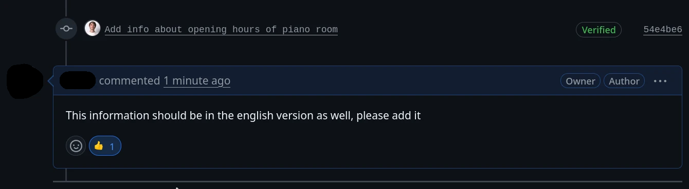

10. To fix the problems, just repeat steps 2--5. The pull request will be automatically updated with your new changes.

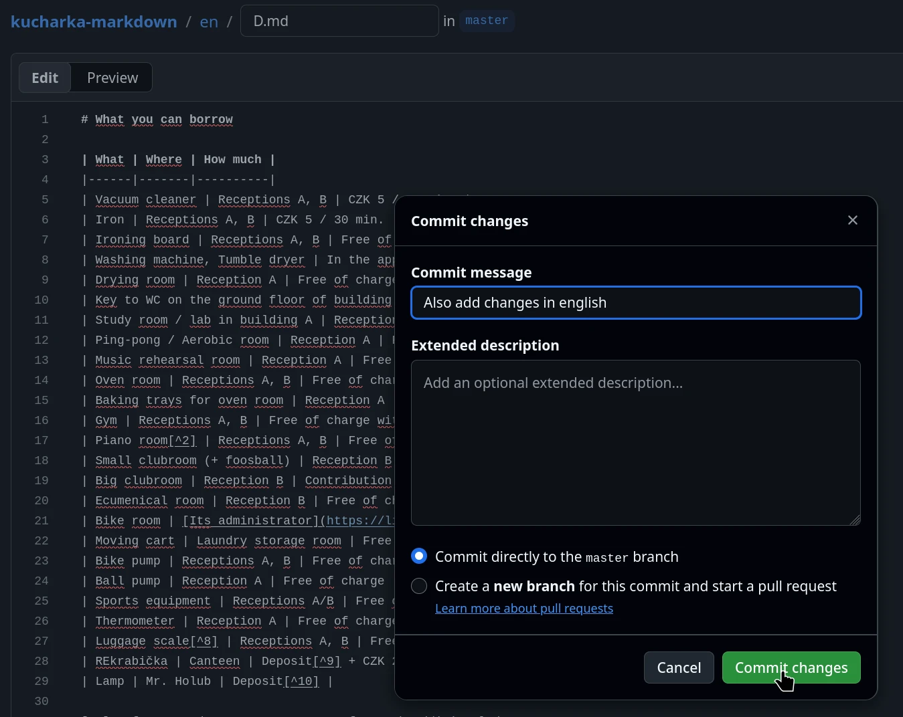

11. Once the maintainers are happy with your changes, they will merge your pull request into the main repository and your contribution will be part of the next release of the guidebook.
